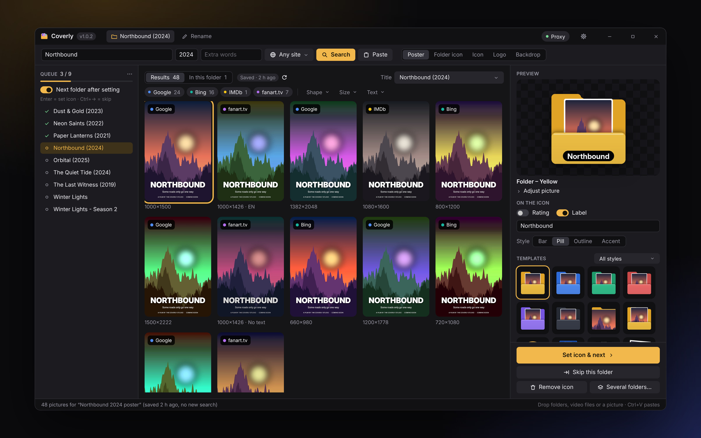
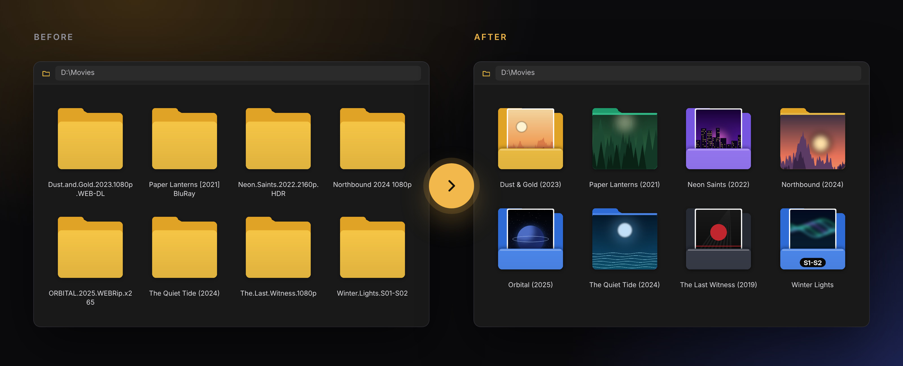
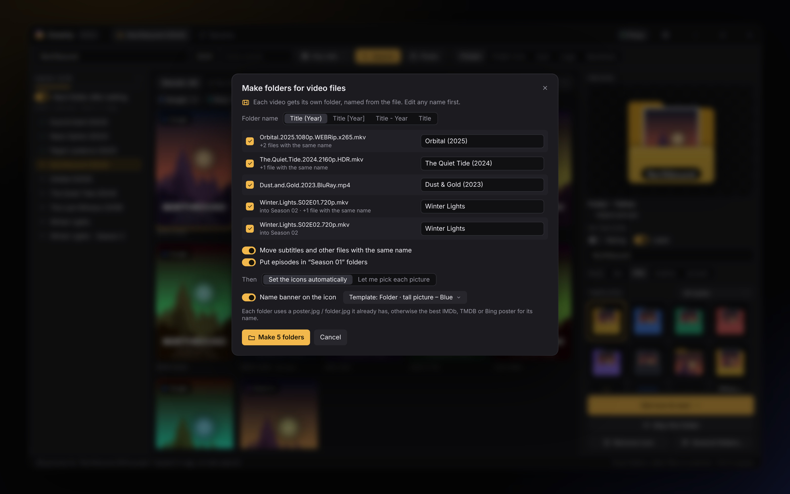
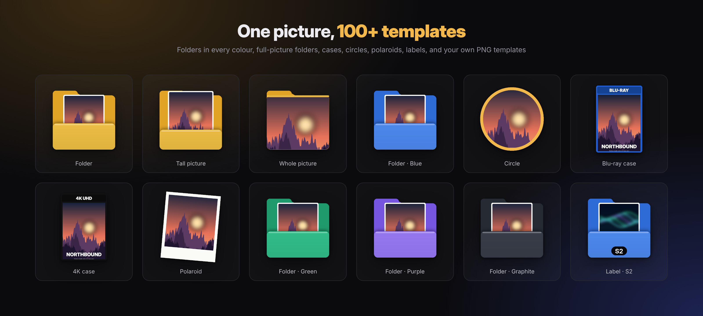

<p align="center">
  
</p>

<h1 align="center">Coverly</h1>

<p align="center">
  Movie and series posters as Windows folder icons.<br>
  Drop your folders (or loose video files), pick a cover, done.
</p>

<p align="center">
  <a href="https://github.com/AmirKenzo/Coverly/releases/latest"></a>
  <a href="https://github.com/AmirKenzo/Coverly/actions/workflows/ci.yml"></a>
  <a href="LICENSE"></a>
  
</p>

<p align="center">
  <a href="https://github.com/AmirKenzo/Coverly/releases/latest"><b>Download for Windows</b></a>
  &nbsp;·&nbsp;
  <a href="#features">Features</a>
  &nbsp;·&nbsp;
  <a href="#build-from-source">Build</a>
</p>

<p align="center">
  
</p>

## From plain folders to posters

<p align="center">
  
</p>

Drop your movie folders on the window. Coverly reads the title and year from each name, finds the posters, and you pick one per folder with <kbd>Enter</kbd>, or let it choose them all by itself.

## Features

- **Drag and drop.** Drop one folder, a hundred folders, or video files. The title, year and season are read from the name and the search starts by itself.
- **Pictures from everywhere, inside the app.** Google, Bing, IMDb, fanart.tv and TMDB, each result marked with its source. Modes for posters, ready-made folder icons, icons, logos and backdrops.
- **Fast queue.** Work through many folders: pick a picture, press <kbd>Enter</kbd> and the next folder opens. Or let Coverly set them all automatically.
- **Labels.** Title, `S2`, or any text on the icon, in four styles, plus the rating from `.nfo` or TMDB.
- **Saved searches.** A search never runs twice, so sites don't rate-limit you.
- **Proxy.** One click on or off (v2rayN and similar), and you choose which sources use it.
- **Rename.** Clean folder names like `Title (Year)` from the matched title.

### Video files become folders

<p align="center">
  
</p>

Drop loose video files and each one gets its own folder: `Interstellar.2014.1080p.mkv` becomes `Interstellar (2014)\`, together with its subtitles, and episodes go into `Show\Season 01\`. Then the icons are set automatically, with or without a name banner.

### 100+ templates

<p align="center">
  
</p>

Windows 11 folders in many colours, full-picture folders, DVD / Blu-ray and 4K cases, steelbooks, VHS, circles, polaroids, frames and more, each with zoom and position controls. You can add your own PNG templates too.

<sub>The films in these pictures are made up.</sub>

## Download

Get **`Coverly-Setup-x.y.z.exe`** from the [latest release](https://github.com/AmirKenzo/Coverly/releases/latest). A portable zip is there too.

Requires Windows 10 or 11. Google search uses Microsoft Edge WebView2, which is built into Windows.

> Start Coverly normally, not "as administrator": Windows blocks drag and drop into programs running as administrator.

## Image sources

| Source     | Key           | Notes                                                       |
|------------|---------------|-------------------------------------------------------------|
| Google     | none          | Runs in a hidden WebView2. If Google asks, solve its check once inside the app. |
| Bing       | none          |                                                             |
| IMDb       | none          | Main poster of the matched title.                           |
| fanart.tv  | free API key  | Posters, logos, clear art, backgrounds.                     |
| TMDB       | API key, optional | Posters in many languages, ratings.                     |

Keys are entered in **Settings**.

## Build from source

You need:

- [Rust](https://rustup.rs), MSVC toolchain, plus "Desktop development with C++" from Visual Studio Build Tools
- [NSIS 3](https://nsis.sourceforge.io/Download), for the installer

Then run:

```bat
build.bat
```

It runs the tests, builds `target\release\coverly.exe` and writes `dist\Coverly-Setup-<version>.exe`.

## Releasing

The version lives in `Cargo.toml`. Bump it, commit, then push a matching tag:

```bash
git tag v1.0.2
git push origin v1.0.2
```

[`.github/workflows/release.yml`](.github/workflows/release.yml) builds on Windows, makes the installer, the portable zip and `SHA256SUMS.txt`, and publishes them as a GitHub release. Only tags on `main` are released, and a tag that doesn't match `Cargo.toml` stops the build.

## Custom templates

Copy `templates\Example - Gold Frame`, change the PNG layers and the numbers in `template.toml`, and put the folder in `%APPDATA%\Coverly\templates` (Settings → Open templates folder).

## Where things are kept

| What               | Where                              |
|--------------------|------------------------------------|
| Settings, templates, crash log | `%APPDATA%\Coverly`     |
| Image and search cache         | `%LOCALAPPDATA%\Coverly`|
| The icon itself    | a hidden `coverly-icon-*.ico` and `desktop.ini` inside each folder |

**Remove icon** puts a folder back the way it was.

## Project layout

```
docs/screenshots/  pictures for this page
src/
  main.rs          window setup
  app.rs           the interface
  ui.rs            colours, icons, widgets
  worker.rs        background work: search, download, render, apply
  search_cache.rs  saved searches
  videos.rs        video files → folders
  name.rs          release name → title, year, season
  folder.rs        desktop.ini, attributes, Explorer refresh
  icon.rs          multi-size .ico
  sources/         Google, Bing, IMDb, fanart.tv, TMDB, local files
  templates/       drawing, text, built-in and custom templates
installer/         NSIS script
```

## License

[MIT](LICENSE)
